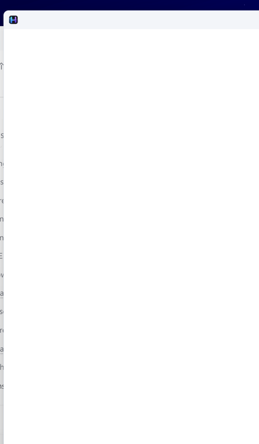
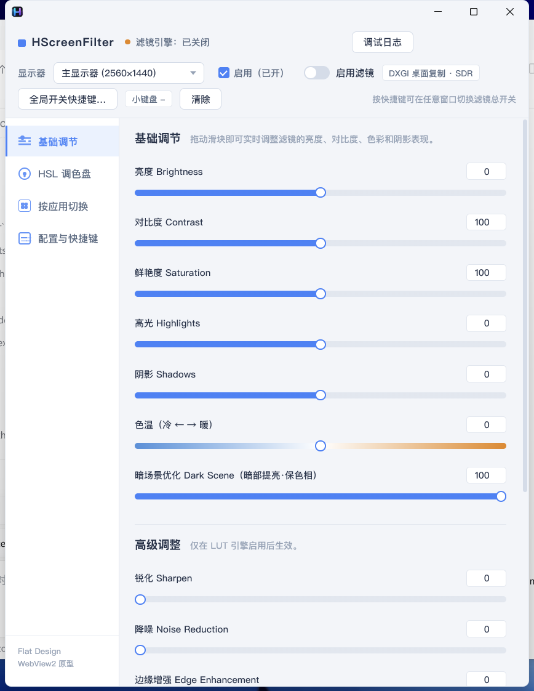
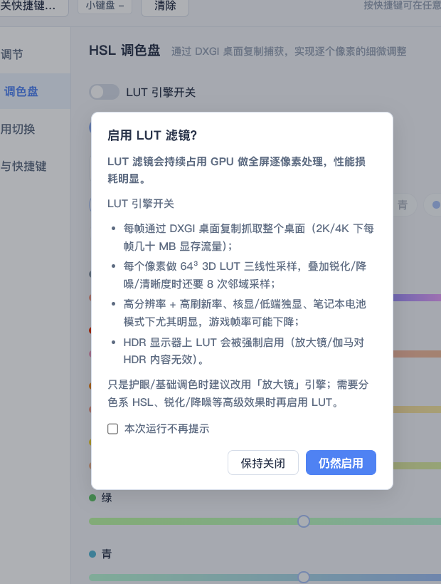
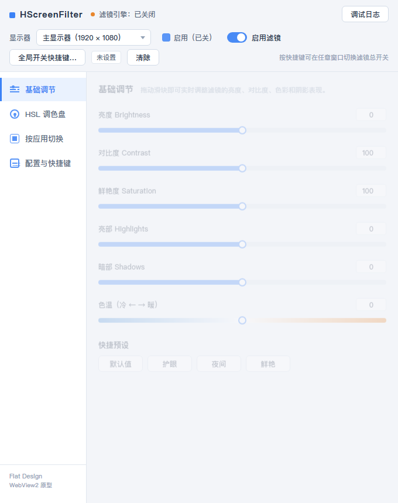
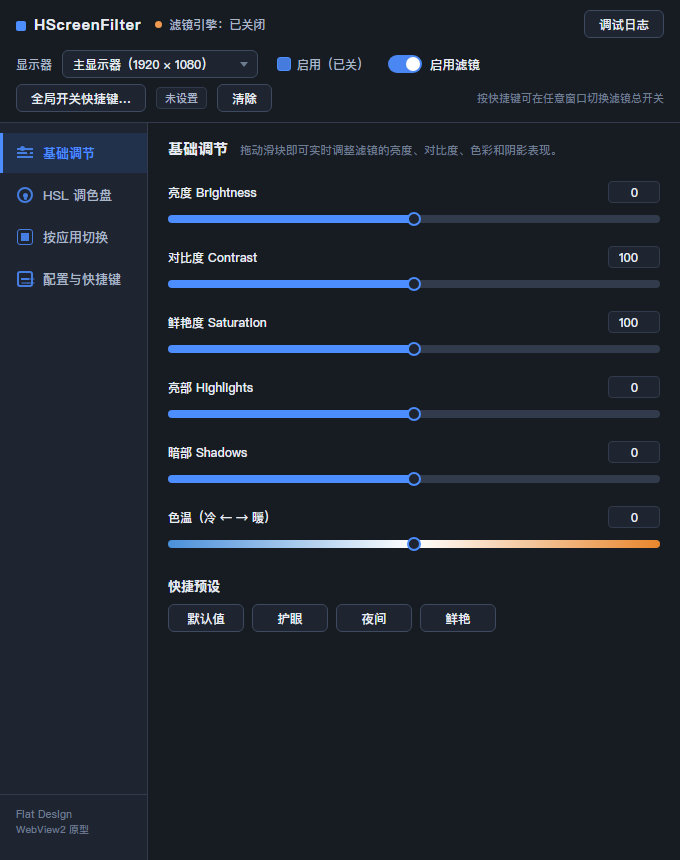
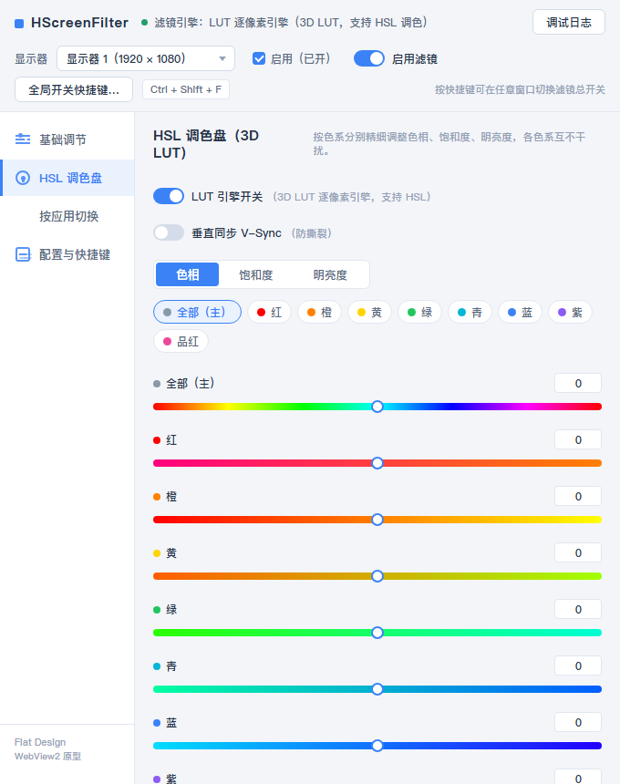
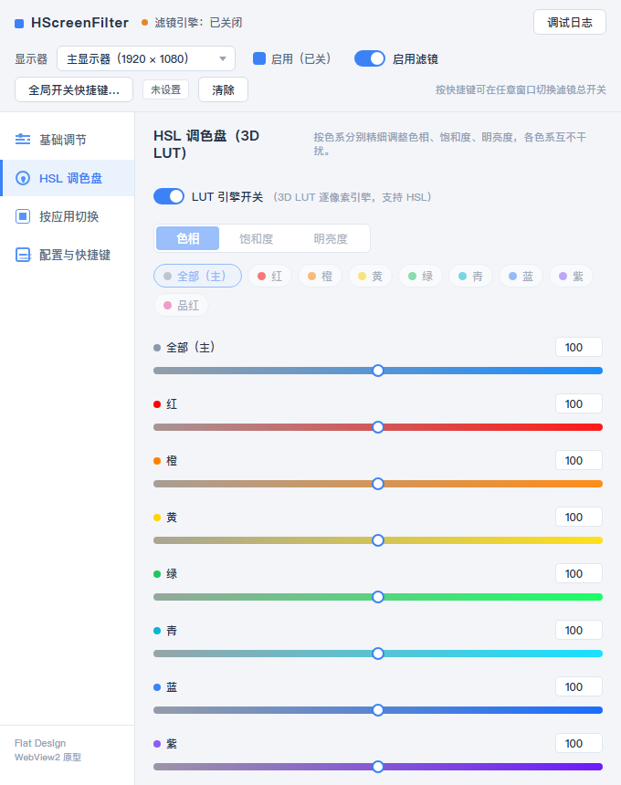
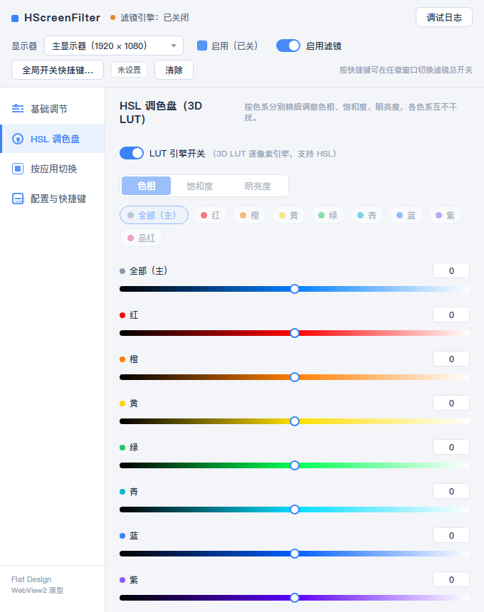
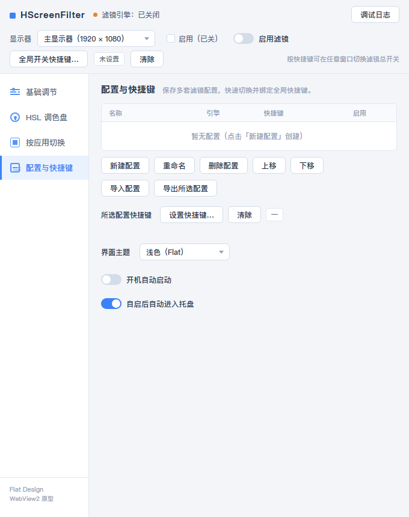

# HScreenFilter 屏幕滤镜 · v2.2.0

**WebView2 桥接版**：C++17 滤镜引擎 + Flat Design 网页 UI（Edge WebView2 承载），
滑块/开关实时驱动真实的滤镜引擎（3D LUT 逐像素 / 放大镜 / 伽马），数据与旧版完全兼容。

> **分支说明**
> - `main` — 当前版本：C++ 引擎 + WebView2 Flat Design UI（本仓库）
> - `legacy` — 原 C#/WinUI 3 版（完整历史与 v1.x 标签保留在 legacy 分支）
> - `dev` — 开发分支

## ✨ 功能

| 页面 | 功能 |
| --- | --- |
| **基础调节** | 亮度 / 对比度 / 鲜艳度 / 亮部 / 暗部 / 色温 滑块（数值可直接输入）+ 快捷预设分**基础**组（默认值/护眼/夜间/鲜艳/游戏暗场景提亮/竞技清晰/冷色办公）与 **LUT** 组（HDR 色彩/电影青橙/风景浓郁/人像柔肤/赛博夜景）；基础组只用基础滑块，LUT 组用到分色系 HSL 与后处理 |
| **高级调整** | 锐化 / 降噪 / 边缘增强 / 清晰度 / 画质增强（LUT 后处理，需启用 LUT 引擎；非 LUT 引擎下参数仍会保存但暂不生效） |
| **HSL 调色盘** | **全部（主）+ 红/橙/黄/绿/青/蓝/紫/品红** 9 通道，色相（全部 ±180° / 分色系 ±30°）/ 饱和度（0..200）/ 明亮度（±30）三字段，Photoshop 式渐变轨道 |
| **色彩管道（DXGI + SDR）** | 取帧固定用 **DXGI 桌面复制**（`DuplicateOutput1` 指定 `B8G8R8A8_UNORM`），整条管道只有一套色彩空间：捕获 SDR 画面 → 64³ 3D LUT → `B8G8R8A8` sRGB 输出，不做任何 HDR10(PQ)/scRGB 转换。HDR 显示器上覆盖层就是一个普通 sRGB 窗口，由 Windows 按「SDR 内容亮度」映射到 HDR 信号，因此观感与桌面一致，也不需要白点设置 |
| **色彩模式状态** | 顶部徽标显示当前链路：`DXGI 桌面复制 · SDR`；自检日志会打印后缓冲与捕获帧的中心像素 R/G/B，可直接确认是 1:1 直通 |
| **HDR 下的引擎选择** | HDR 显示器上放大镜/伽马引擎作用于合成面、对 HDR 桌面等于失效，因此检测到 HDR 时自动改用 LUT 引擎（界面开关显示为开且锁住；不改动用户保存的设置） |
| **界面** | 标题栏与界面同色并隐藏系统标题文字（WinUI 观感、跟随系统深色模式）；高级调整在 LUT 引擎未运行时整块禁用；全局快捷键显示支持小键盘按键（小键盘 - / Enter …） |
| **按应用切换** | 添加/编辑/删除检测应用、3 秒倒计时拾取前台应用、后台线程 500ms 轮询前台自动切换绑定配置或自动关闭 |
| **配置与快捷键** | 配置列表（名称/引擎/快捷键/启用，n选1）、新建/重命名/删除/导入/导出/上移/下移、每配置全局热键 + 全局开关快捷键（低级钩子捕获）、开机自启、自启进托盘 |
| **LUT 性能确认** | 手动启用 LUT、启用 LUT 配置、点击 LUT 组预设时，先弹出性能损耗确认（DXGI 全屏捕获 + 64³ LUT 逐像素采样 + 后处理邻域采样；高分辨率/高刷/核显/电池模式下影响更明显），可「仍然启用 / 保持关闭」，本次运行内可不再提示 |
| **偏好持久化** | 滤镜总开关、显示器启用、按应用切换、开机自启、自启进托盘、界面主题均立即写入 `profiles.json`；开机自启状态以注册表实际值为准，失败时界面回滚并提示 |
| **显示滤镜实时帧率** | 打开后**覆盖层右上角**直接显示实时帧率（半透明小徽标，跟随滤镜层、不参与渲染），界面标题栏右侧同步显示数字；日志每秒写一条帧率明细（呈现帧率 / 帧间隔 最小-均值-最大 / >20ms 长间隔次数 / 取帧·探测回读·准备·绘制+呈现 分段耗时 / **循环周期 · 未计时间(线程被抢占/循环外)** / **重复帧未重绘（其中仅指针）/ 源帧累积跳过 / 脏区合并** / 无新帧轮询 / 探测未就绪 / LUT 重建次数），用来在实际游戏里定位「一顿一顿」。判读：`单帧合计(我们)` 一直是零点几毫秒而我们自己的开销没变、`未计时间` 却很大 = 渲染线程被系统抢占了；`取帧等待` 大且 `源帧累积跳过` 猛增 = 桌面合成/复制把帧送晚了 |

> 日志只有一个文件：`%LocalAppData%\HScreenFilter\debug.log`（界面「调试日志」按钮直接打开），
> 宿主与滤镜引擎的记录都在里面（宿主行带 `[App]` 分类）。

- **滤镜层强制垂直同步**：窗口模式固定 `Present(1)`，**不用帧延迟等待对象** —— 每一帧都由 DWM
  交给下一个 vblank 呈现，应用侧不猜合成相位（`SyncInterval 0` + 等待对象那套一旦错过一次合成
  窗口就掉到 1/2、1/3 节拍，180 → 90/60）；`SetMaximumFrameLatency(1)` 把队列压到最多 1 帧在飞。
  flip 队列有空位时 `Present` 立即返回（日志里 `Present 阻塞` ≈ 0），队满时才阻塞到 vblank。
  界面上的「垂直同步」开关显示为开且锁住。
- **启动保护期 & 统计预热**：引擎启动后 1.5s 内不做「全黑帧」判定、不为异格式帧做诊断采样
  （DXGI 刚建立捕获时 flip 池还没分配好，头几帧经常全黑/格式未定）—— 避免覆盖层反复 Show/Hide；
  启动后 1s 内的呈现不记入帧率统计（第一次 `AcquireNextFrame` 可能阻塞几百毫秒，会把整秒统计带偏），
  覆盖层从隐藏恢复后的第一帧同样只重建基准，不把隐藏时长算成「帧间隔」。
- **不做无效渲染**：桌面位图没变、也没有新指针形状（`LastPresentTime == 0`，只有指针在动）的帧
  直接跳过重绘与呈现 —— 同一张图再送进合成器就是果冻/顿挫，帧率统计也会虚高；
  覆盖层隐藏期间不再逐帧拷贝整屏纹理（1440p 一帧 ≈14MB）。帧率统计也改成只计**真的呈现出去**的帧
  （原来隐藏期间能报到 400+ 帧/秒）。日志里的 `源帧累积跳过` = 操作系统合并掉的源帧数
  （`AccumulatedFrames`），它才是「滤镜跟没跟上桌面」的直接判据。
- **日志异步写盘**：渲染线程/UI 线程只把整行文本推进队列，后台写线程批量落盘 ——
  日志文件在 `%LocalAppData%`，被安全软件/索引盯着时偶发 0.5~0.9 秒的写盘阻塞，
  原来同步写会把渲染线程（以及整屏合成）一起卡住，表现为滤镜帧率 20~30 乱跳、画面一顿一顿。
- **LUT 重建限速**：拖动滑块时参数每帧都在变，而每次重建要跑 64³ 计算着色器；
  现在最快 30ms 一次（≈33 次/秒），视觉无差别、GPU 开销砍掉大半，拖动时也不掉帧。

- **顶部常驻**：显示器选择 + 每显示器启用 + 滤镜总开关 + 全局开关快捷键（含清除）
- **托盘菜单**：启用滤镜（勾选）、全部配置列表切换、显示/退出；最小化/关闭进托盘
- **主题**：跟随系统 / 浅色 / 深色（Flat），保存提示「配置发生改变，是否保存至\n{配置名}」
- **窗口**：最小尺寸按系统缩放/工作区自适应（1080p 高缩放下自动缩小），可拉大

## 🧪 本次修复验证（2026-10-22）

| 自启白屏（修复前） | 自启后从托盘恢复（修复后） |
| --- | --- |
|  |  |

LUT 启用前的性能损耗确认（开关 / LUT 配置 / LUT 预设三处触发）：



## 🖼️ 界面预览

| 浅色 | 深色 |
| --- | --- |
|  |  |

| HSL 色相轨道 | HSL 饱和度轨道 | HSL 明亮度轨道 | 配置页 |
| --- | --- | --- | --- |
|  |  |  |  |

## 🛠️ 技术要点

- **引擎**：64³ 3D LUT 管线（cs_5_0 计算着色器并行生成 LUT + 单遍像素着色器三线性采样），
  HSL 软掩码 → OKLab 感知空间 → 暗部衰减，与旧版逐行一致；
  单遍内联做线性光邻域后处理（锐化 Unsharp Mask、降噪、边缘增强、清晰度、画质增强），
  无中间浮点纹理与全屏清屏，五项后处理全为 0 时走 `PostActive` 快路径（1 次输入采样 + 1 次 LUT 采样）；
  引擎回退链：LUT 逐像素 → 放大镜颜色矩阵 → 显卡伽马曲线。
- **自愈**：捕获失效（显示模式切换 / 独占全屏 / DSR）带退避重试并自动隐藏覆盖层，恢复后继续渲染；
  5 秒看门狗重建已停止的引擎、重设被驱动重置的伽马曲线。
- **启动路径（白屏 / 首启卡顿修复）**：自启进托盘时窗口也必须先「显示」再创建 WebView2 控制器
  —— 在从未显示的窗口上初始化只会得到一张白底窗口，之后从托盘恢复也不会重绘。现在先把窗口显示在
  屏幕外，页面 `ready` 后隐藏归位；WebView2 失败/超时会把窗口移回屏幕内并给出错误框。滤镜启动改为
  页面就绪后错峰执行，着色器在后台预编译并进程级缓存，启动自检延后到 5 秒且只做一次 ——
  避免和 WebView2 冷启动同时抢 GPU/CPU，也避免启动窗口里插入整张 LUT 的 GPU 回读。
- **全 GPU 链路**：捕获帧直接以 SRV 进像素着色器（3D LUT 采样 + 输入/输出色彩空间）→ 交换链后缓冲 → `Present`，
  每帧没有任何 CPU 拷贝；唯一的 GPU→CPU 回读是每秒一次的 16×80 像素场景探测（全黑帧护栏 + 暗场景优化用），
  且**延迟一帧读取**，不在呈现链路上留同步点（旧的「同拍 Map」会每秒卡顿一次）。
- **UI**：WebView2 承载 webui2（HTML/CSS/JS，Flat Design），
  宿主 ↔ 页面通过 `PostWebMessageAsJson` / `postMessage` 双向桥接完整状态；
  滑块范围/预设/保存语义与原版严格一致。
- **数据**：`%LocalAppData%\HScreenFilter\profiles.json`，字段与原 C#/C++ 版完全兼容。

## 🔨 构建

前置：**便携 llvm-mingw 工具链**（`LLVM_MINGW` 环境变量）+ WebView2 SDK（`tools/webview2`，构建脚本自动部署）。

```powershell
.\build.ps1                  # 主程序（C++ 原生版，输出 build\HScreenFilter.exe）
.\build-release.ps1          # v2.2.0 发布版（输出 dist\HScreenFilter-v2.2.0\ + zip）
```

## 🚀 运行

```powershell
.\build\HScreenFilter.exe --selftest   # 主程序自检
dist\HScreenFilter-v2.2.0\HScreenFilter.exe   # 发布版（需系统已装 WebView2 Runtime）
```

## 📁 源码结构

```
src\
├── common.* / log.* / json.* / models.* / store.*   # 基础与数据（profiles.json 兼容）
├── autostart.* / monitors.* / msgwindow.* / hotkeys.* / fgwatcher.*
├── engines\
│   ├── hlsl.*                  # LUT 计算/采样着色器 + D3DCompile 封装
│   ├── lut_engine.*            # DXGI 覆盖层 + 桌面捕获 + 3D LUT 管线（主引擎）
│   ├── mag_engine.* / gamma_engine.* / filter_engine.*
├── ui\main_window.*            # C++ 原生版 UI（legacy 交互参照）
└── app_main.cpp                # 发布版宿主（桥接引擎与页面）
webui2\                         # Flat Design UI（index.html / styles.css / app.js）
previews\                       # 界面效果图
```

## 📜 许可证

GPL-3.0。
