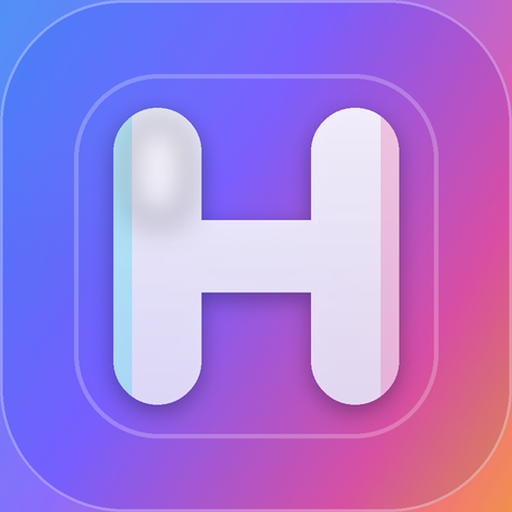

<div align="center">



<h1>HScreenFilter</h1>

<p><b>Windows 屏幕滤镜 · 实时 3D LUT 调色覆盖层</b></p>

<p>捕获桌面 → 64³ 3D LUT 逐像素调色 → 点击穿透覆盖层呈现</p>

<p>
  <a href="https://github.com/Htonng/HScreenFilter/releases/latest"></a>
  
  
  
  
  <a href="https://github.com/Htonng/HScreenFilter/stargazers"></a>
</p>

<p>
  <a href="#快速开始">快速开始</a> ·
  <a href="#效果预览">效果预览</a> ·
  <a href="#功能">功能</a> ·
  <a href="#下载">下载</a> ·
  <a href="#构建">构建</a> ·
  <a href="#开源协议">开源协议</a>
</p>

</div>

**WebView2 桥接版**：C++17 滤镜引擎 + Flat Design 网页 UI（Edge WebView2 承载）。
滑块/开关实时驱动真实的滤镜引擎（3D LUT 逐像素 / 放大镜 / 伽马），数据与旧版完全兼容。

> 分支：`main` 为当前 C++ 引擎 + WebView2 UI；`legacy` 保留原 C#/WinUI 3 版与 v1.x 历史；`dev` 为开发分支。

## 快速开始

1. 下载 [最新发布包](https://github.com/Htonng/HScreenFilter/releases/latest)，解压到任意目录。
2. 确认 `HScreenFilter.exe`、`WebView2Loader.dll`、`webui2\` 在同一目录。
3. 运行 `HScreenFilter.exe`，在顶部打开「启用滤镜」。
4. 首次使用需要 **Microsoft Edge WebView2 Runtime**（Windows 10/11 通常已随系统或 Edge 安装）。

> **从 v2.3.0 升级**：v2.3.0 存在「打开滤镜全黑屏」问题（工作纹理继承共享标志 + 覆盖层自捕获），
> 请使用 **v2.3.1** 或更高版本。详见 [CHANGELOG](CHANGELOG.md)。

## 效果预览

| 浅色 | 深色 |
| --- | --- |
|  |  |

| HSL 色相轨道 | HSL 饱和度轨道 | HSL 明亮度轨道 | 配置页 |
| --- | --- | --- | --- |
|  |  |  |  |

<details>
<summary>历史修复对比（v2.2.0：自启白屏 / LUT 性能确认）</summary>

| 自启白屏（修复前） | 自启后从托盘恢复（修复后） |
| --- | --- |
|  |  |


</details>

## 功能

| 页面 | 功能 |
| --- | --- |
| **基础调节** | 亮度 / 对比度 / 鲜艳度 / 高光 / 阴影 / 色温 / 暗场景优化 7 个滑块（数值可直接输入），以及游戏暗场景提亮、护眼、夜间、鲜艳、竞技清晰、冷色办公等预设 |
| **高级调整** | 锐化 / 降噪 / 边缘增强 / 清晰度 / 画质增强（LUT 后处理，需启用 LUT 引擎；非 LUT 引擎下参数仍会保存但暂不生效） |
| **HSL 调色盘** | 全部（主）+ 红/橙/黄/绿/青/蓝/紫/品红 9 通道，色相（全部 ±180° / 分色系 ±30°）/ 饱和度（0..200）/ 明亮度（±30）三字段，Photoshop 式渐变轨道 |
| **色彩管道（DXGI + SDR）** | 取帧固定用 DXGI 桌面复制（`DuplicateOutput1` 指定 `B8G8R8A8_UNORM`），整条管道只有一套色彩空间：捕获 SDR 画面 → 64³ 3D LUT → `B8G8R8A8` sRGB 输出。HDR 显示器上覆盖层是普通 sRGB 窗口，由 Windows 按「SDR 内容亮度」映射 |
| **渲染分层** | 捕获（`DesktopCapture`）/ 处理（`ColorProcessor`）/ 呈现（`OverlayPresenter`）三层只通过纹理、SRV/RTV、帧元数据通信；`FilterEngine` 保证 LUT / 放大镜 / 伽马任何时刻只有一个后端生效。扩展指南见 [渲染分层与扩展指南](docs/渲染分层与扩展指南.md) |
| **HDR 下的引擎选择** | HDR 显示器上放大镜/伽马引擎对 HDR 桌面等于失效，检测到 HDR 时自动改用 LUT 引擎（界面开关显示为开且锁住；不改动用户保存的设置） |
| **按应用切换** | 添加/编辑/删除检测应用、3 秒倒计时拾取前台应用、后台线程 500ms 轮询前台自动切换绑定配置或自动关闭 |
| **配置与快捷键** | 配置列表（名称/引擎/快捷键/启用）、新建/重命名/删除/导入/导出/上移/下移、每配置热键 + 全局开关快捷键、开机自启、自启进托盘 |
| **偏好持久化** | 总开关、显示器启用、按应用切换、开机自启、界面主题立即写入 `profiles.json`；基础参数（含暗场景优化）随配置保存/导出/导入，并由 `FilterSettings::Equals` 参与未保存修改判定 |
| **实时帧率** | 覆盖层右上角显示实时帧率 + 界面数字同步；日志每秒写一条帧率明细（取帧/探测/准备/绘制分段、长间隔、源帧累积、LUT 重建次数），用于定位游戏内卡顿 |

- **顶部常驻**：显示器选择 + 每显示器启用 + 滤镜总开关 + 全局开关快捷键（含清除）
- **托盘菜单**：启用滤镜（勾选）、全部配置列表切换、显示/退出；最小化/关闭进托盘
- **主题**：跟随系统 / 浅色 / 深色（Flat）
- **窗口**：最小尺寸按系统缩放/工作区自适应（1080p 高缩放下自动缩小），可拉大

> 日志只有一个文件：`%LocalAppData%\HScreenFilter\debug.log`（界面「调试日志」按钮直接打开），
> 宿主与滤镜引擎的记录都在里面（宿主行带 `[App]` 分类）。

## 下载

| 文件 | 说明 |
| --- | --- |
| [HScreenFilter-v2.3.1.zip](https://github.com/Htonng/HScreenFilter/releases/latest) | 推荐。包含 `HScreenFilter.exe`、`WebView2Loader.dll`、`webui2\` |
| [历史版本](https://github.com/Htonng/HScreenFilter/releases) | 查看全部 release 与变更说明 |

运行前提：**Windows 10 1903+ / Windows 11**、**WebView2 Runtime**。
LUT 引擎需要可用的 D3D11 显卡；不可用时自动回退到放大镜/伽马曲线。

> `Captureable` / `--capturable` 字段保留但不再生效：LUT 覆盖层固定
> `WDA_EXCLUDEFROMCAPTURE`。覆盖层若允许桌面复制捕获，会抓到自己的输出并自反馈全黑，
> 因此第三方录制工具看不到滤镜层。这是当前架构下的硬性取舍。

## 构建

前置：**便携 llvm-mingw 工具链**（`LLVM_MINGW` 环境变量，或脚本内置的 `D:\tools` / `F:\tools` 路径）
\+ WebView2 SDK（`tools/webview2`，构建脚本自动部署）。

```powershell
.\build.ps1                  # 主程序（C++ 原生版，输出 build\HScreenFilter.exe）
.\build-release.ps1          # v2.3.1 发布版（输出 dist\HScreenFilter-v2.3.1\ + zip）
```

自检 / 引擎测试：

```powershell
.\build\HScreenFilter.exe --selftest            # JSON、参数表、着色器、D3D11、5×5 矩阵
.\build\HScreenFilter.exe --enginetest=8        # 实际应用 LUT，8 秒后自检
.\build\HScreenFilter.exe --enginetest-cycle    # 覆盖层隐藏/恢复回归
```

## 技术要点

- **引擎**：64³ 3D LUT 管线（cs_5_0 计算着色器并行生成 LUT + 单遍像素着色器三线性采样），
  HSL 软掩码 → OKLab 感知空间 → 暗部衰减；单遍内联做线性光邻域后处理（锐化 / 降噪 /
  边缘增强 / 清晰度 / 画质增强），五项后处理全为 0 时走 `PostActive` 快路径。
  回退链：LUT 逐像素 → 放大镜颜色矩阵 → 显卡伽马曲线。
- **单一后端**：LUT 按显示器创建覆盖层；任何一台启动失败都会先拆除全部 LUT 覆盖层再整体回退，
  避免「部分显示器 LUT + 全局放大镜」同屏叠加；进入 LUT 前强制复位放大镜/伽马。
- **覆盖层排除自身捕获**：LUT 覆盖层固定 `WDA_EXCLUDEFROMCAPTURE`；工作纹理固定
  `MiscFlags=0`，不继承 DXGI 捕获源的共享/键控互斥标志。两者都是「打开滤镜全黑屏」的根因。
- **自愈**：捕获失效（显示模式切换 / 独占全屏 / DSR）带退避重试并自动隐藏覆盖层，恢复后继续渲染；
  5 秒看门狗重建已停止的引擎、重设被驱动重置的伽马曲线。
- **全 GPU 链路**：捕获帧直接以 SRV 进像素着色器 → 交换链后缓冲 → `Present`，每帧没有 CPU 拷贝；
  唯一的 GPU→CPU 回读是每秒一次的场景探测，且延迟一帧读取，不在呈现链路上留同步点。
- **启动路径**：自启进托盘时先把窗口显示在屏幕外再创建 WebView2 控制器，页面 `ready` 后隐藏归位；
  滤镜启动错峰执行，着色器后台预编译并进程级缓存，启动自检延后到 5 秒且只做一次。
- **UI**：WebView2 承载 `webui2/`（HTML/CSS/JS，Flat Design）；宿主 ↔ 页面通过
  `PostWebMessageAsJson` / `postMessage` 双向桥接完整状态。
- **数据**：`%LocalAppData%\HScreenFilter\profiles.json`，字段与原 C#/C++ 版完全兼容。

## 源码结构

```text
src\
├── common.* / log.* / json.* / models.* / store.*   # 基础与数据（profiles.json 兼容）
├── autostart.* / monitors.* / msgwindow.* / hotkeys.* / fgwatcher.*
├── engines\
│   ├── hlsl.*                  # LUT 计算/采样着色器 + D3DCompile 封装
│   ├── render\
│   │   ├── desktop_capture.*   # 捕获层：DXGI 桌面复制 → 固定 BGRA8 工作纹理 + 场景采样
│   │   ├── color_processor.*   # 处理层：参数 → 64³ LUT / 后处理 / 暗场景权重
│   │   └── overlay_presenter.* # 呈现层：覆盖层窗口 + flip 交换链 + Present + OSD
│   ├── lut_engine.*            # 渲染协调层：设备/线程/自愈/统计
│   ├── mag_engine.* / gamma_engine.* / filter_engine.*
├── ui\main_window.*            # C++ 原生版 UI（legacy 交互参照）
└── app_main.cpp                # 发布版宿主（桥接引擎与页面）
webui2\                         # Flat Design UI（index.html / styles.css / app.js）
docs\渲染分层与扩展指南.md       # 三层边界、后端互斥、新增参数/效果的步骤
previews\                       # 界面效果图
```

## 支持版本

- **系统**：Windows 10 1903+、Windows 11（依赖 DXGI 桌面复制与 WebView2）
- **运行时**：Microsoft Edge WebView2 Runtime
- **显卡**：支持 D3D11 的显卡；不可用时回退放大镜/伽马
- **HDR**：自动使用 LUT 引擎；放大镜/伽马对 HDR 内容无效
- **已知限制**：独占全屏游戏可能暂停覆盖层捕获（恢复后自动继续）；第三方录制看不到
  LUT 覆盖层（见「下载」中的 `Captureable` 说明）

## 开源协议

GPL-3.0，详见 [LICENSE](LICENSE)。

变更记录见 [CHANGELOG](CHANGELOG.md)。
